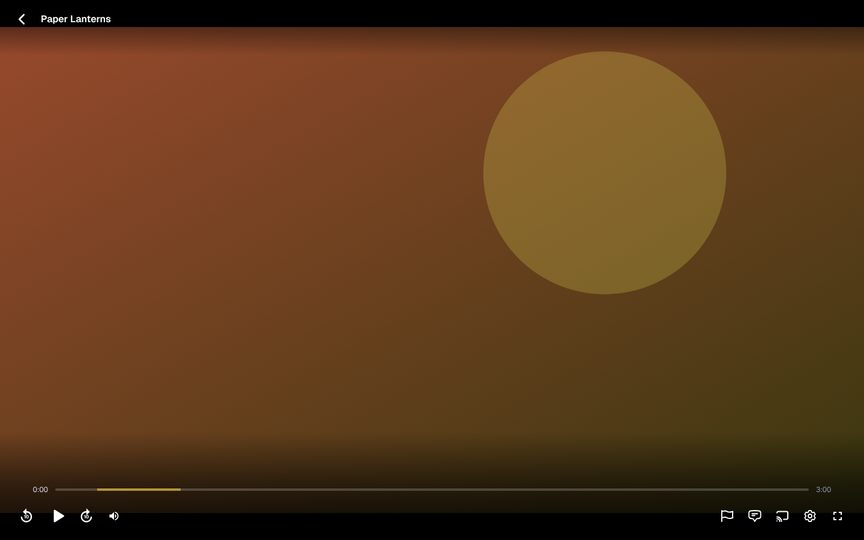
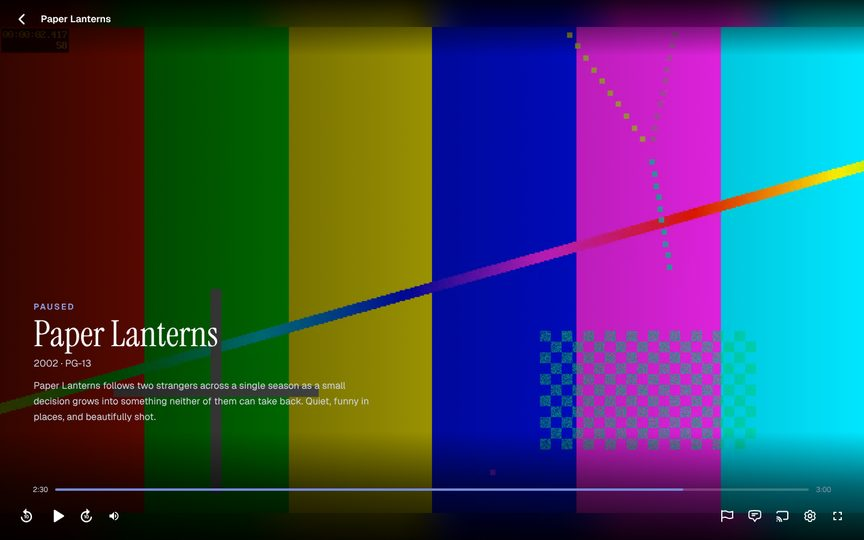
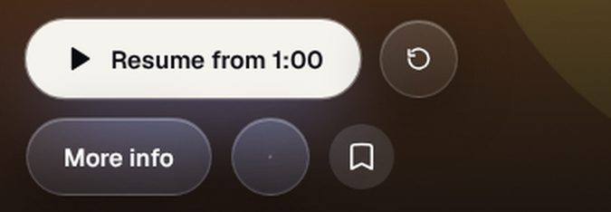
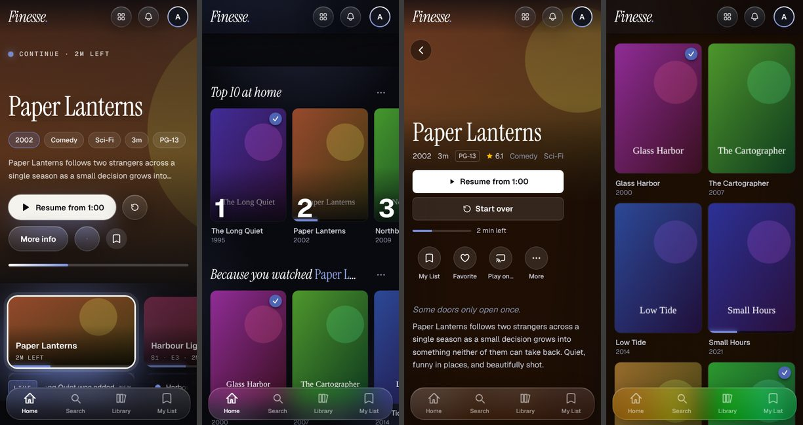
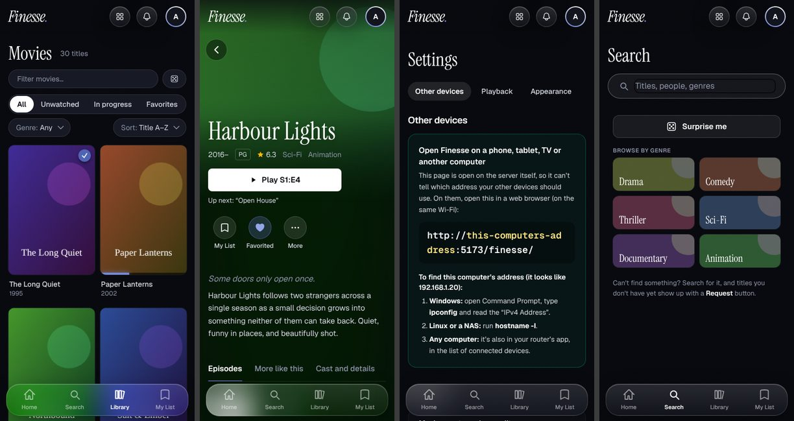
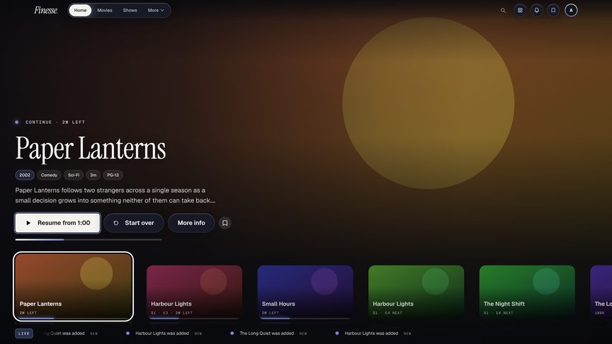
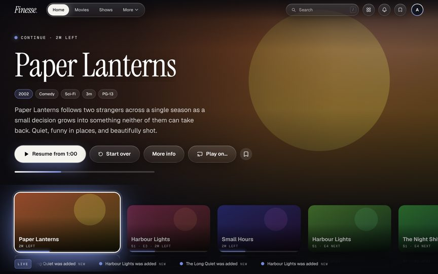
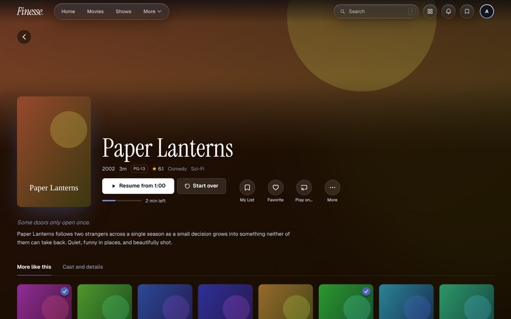

# Finesse review — Phase 1 (look, don't touch)

Reviewed on 2026-11-09. Nothing in either repo's code was changed. This file and the
screenshots in `docs/review/` are the only new files.

## Read this first

**What I reviewed is GitHub, not your Windows folder.** I ran in a Linux cloud session, so I
worked from `CoffeeCC/finesse` master (**3.2.8**, commit `7dc03c6`) and
`CoffeeCC/finesse-android` master (`4a1b56a`, v0.1.1).

- **Couch mode isn't on GitHub.** `?couch=1`, `isCouch()`, `src/lib/keymap.ts` and
  `src/components/ScrollRow.tsx` don't exist on master or on any pushed branch, and your notes
  mention 3.2.9. That work must be unpushed on your machine. With `?couch=1` the app here simply
  shows the desktop layout, so **I could not review couch mode**. I tested the TV layout instead
  (a TV user agent at 1920×1080, driven with arrow keys). Push that work and I'll do couch
  properly.
- **File and line numbers below are for 3.2.8** and may have moved in your tree.

**How I tested the web app.** A small mock Finesse + Jellyfin backend (30 films, 10 shows, a
3-minute H.264 test video, subtitles, intro markers), the dev server and the production build,
driven in real Chrome at 1440×900, 375×812 (touch) and 1920×1080 (TV). The mock, `.env.local`
and all servers are gone again.

**What I could not check**

| Not checked | Why |
|---|---|
| Couch mode | Not in the repo (above) |
| Android builds, unit tests, Desktop Head Unit | No Android SDK in this session. Everything about Android is from reading the code, plus Google's documentation where I say so |
| Android Auto on a real car or phone | Same. Items marked **(from code)** need a run on the DHU or a car before and after any fix |
| Real transcoding, HLS, audio sync, HEVC/HDR, image subtitles | The mock only serves a direct-play file. The HLS findings are from reading `PlayerPage.tsx` |
| A real LG TV (Chromium 68) | Chrome with a TV user agent is not the TV. I did not run `build:webos` on a device |
| Frame drops | Headless Chrome has no GPU here, so its dropped-frame counts mean nothing. I measured script time instead |
| The server's stack code in depth | I read `auth.ts`, `http/*`, `services.ts`, `policy.ts`, `app.ts` closely and spot-checked updates, invites, browser play and maintenance. I did **not** read every file in `server/src/stack/`, `setup/`, `streaming.ts`, `groups.ts` or `parental.ts` line by line |

**Baseline on 3.2.8 (Linux, Node 22):** `npm run build` passes, `npm run server:typecheck`
passes, `npm run server:test` passes 608 of 608.

**Measured (production build, local mock)**

| Screen | First paint | Largest paint | Layout shift | Script time blocking the page |
|---|---|---|---|---|
| Home, desktop | 340 ms | 1.07 s | **0.144** | 0.33 s |
| Home, desktop, CPU slowed 4× | 916 ms | 1.85 s | **0.145** | **1.9 s** |
| Home, phone width, CPU slowed 4× | 556 ms | 1.25 s | **0.120** | **1.4 s** |
| A film's page, desktop | 296 ms | 732 ms | 0.080 | 0.12 s |
| A library, CPU slowed 4× | 600 ms | 772 ms | 0.005 | 0.64 s |
| Player, CPU slowed 6×, 10 s of playback | 700 ms | 1.5 s | 0 | 0.07 s |

(Google calls layout shift under 0.1 "good".) The player starts a direct-play film in about
1.5–1.8 s and stays light while playing, even slowed 6×. Bundle: main file 729 kB (231 kB
gzipped), player 591 kB (184 kB, mostly hls.js), CSS 174 kB.

---

## The ranked list

Sizes: **S** = an hour or two, **M** = about a day, **L** = several days.
"Android" = `finesse-android`. "Web" = `finesse`.

### 1. Finesse Video treats reversing as parked — Android, S — safety

- **Saw:** `video/src/main/java/com/coffeecc/finesse/video/ParkedGate.kt:53`. The test for
  moving is `metersPerSecond >= 1f`. Google's documentation for `Speed` says the value is
  "positive when the vehicle is moving forward, negative when moving backwards". A car reversing
  at any speed reads below 1, so it counts as stopped. After 10 seconds of reversing the gate
  says Parked and the picture can show and play. A reading that isn't a real number (NaN) also
  counts as stopped.
- **Why it matters:** video can play while the car moves. This is the one thing the app must
  never do.
- **Fix:** compare the size of the speed (`abs`), and treat any reading that isn't a finite
  number as Unknown.

### 2. An "unknown" speed reading doesn't cancel the countdown to Parked — Android, S — safety

- **Saw:** `ParkedGate.kt:48-52`. When the car reports that it can't give a speed, the state
  becomes Unknown, but `stoppedSince` is kept and the 10-second timer keeps running. Sequence:
  speed 0 at second 0, "speed not available" at second 2, the timer fires at second 10 and sets
  **Parked**, although the last thing the car said was "I don't know". Also, after any Unknown
  spell, a single reading of 0 makes it Parked instantly (line 61), with no new 10-second wait,
  even if the car moved during the gap.
- **Why it matters:** the README promises "if the car doesn't share its speed, video stays
  off". This path breaks that promise.
- **Fix:** on Unknown, clear `stoppedSince` and cancel the timer. Parked needs 10 unbroken
  seconds of good readings below the limit, and the timer checks the latest reading before it
  says Parked.

### 3. Parked never expires if the car stops sending its speed — Android, S — safety, your call

- **Saw:** `ParkedGate.kt`. Once Parked, the only way out is a new reading of 1 m/s or more.
  If readings stop arriving (the car or Android Auto stops sending them, or pauses them while
  another app is on screen), the gate stays Parked for as long as the screen lives. The code
  comment says a stopped car "may not report its speed again", so this was a deliberate
  trade-off.
- **Why it matters:** "fail closed when the speed is unknown" should include "I haven't heard
  from the car for a while".
- **Fix and question:** note the time of the last good reading. While video is showing, if no
  reading has arrived for N seconds, go to Unknown (pause and cover). **I need one fact first:**
  does a parked car keep sending speed 0 through Android Auto, or does it go quiet? The DHU or
  one drive answers that. If cars keep sending, N = 5 seconds is safe and invisible. If they go
  quiet, a watchdog would stop video for everyone, and item 4 becomes the main protection.
  **My recommendation:** measure first, then add the watchdog if readings are regular.

### 4. "Stopped for 10 seconds" includes every red light — Android, S — safety, your call

- **Saw:** `ParkedGate.kt:36` and `VideoPlayerScreen.kt:275-282`. Parked means "under 1 m/s for
  10 s". That's true at a traffic light or in a queue, and 1 m/s (2.2 mph) is also a slow creep
  in traffic.
- **Why it matters:** a driver can press Play at a red light. The video stops when the car
  pulls away, but it shouldn't have started.
- **Fix:** Android Auto can enforce "parked" itself. Wrapping the Play button's action, and the
  taps on list rows that open the player, in `ParkedOnlyOnClickListener` makes Android Auto
  refuse the tap unless the car reports it is really parked, and show its own "only while
  parked" message. Keep the speed gate as the thing that stops video. Starting would then need
  both. Also lower the limit from 1 m/s to about 0.3. **(from code and Google's documentation:
  whether Android Auto accepts a parked-only action in that button strip must be tried on the
  DHU. If it doesn't, the same wrapper on the list rows still covers starting.)**
  **My recommendation:** do it.

### 5. The safety logic has no tests and reads the wall clock — Android, S/M

- **Saw:** `video/` has no test folder. `ParkedGate` mixes the rules with Android classes, so
  the rules can't be tested alone. It times the 10 seconds with `System.currentTimeMillis()`
  (lines 43, 58), which jumps when the phone corrects its clock, something phones do when they
  connect to a car. A forward jump makes the wait pass early.
- **Why it matters:** items 1 to 3 are exactly what a ten-line test would have caught, and this
  code can't be allowed to regress.
- **Fix:** move the rules into a small plain class (readings and a clock go in, a state comes
  out), use `SystemClock.elapsedRealtime()`, and test every sequence: reverse, NaN, unknown in
  the middle of the wait, unknown then one zero, readings stopping, clock jumps. Add
  `./gradlew :video:testDebugUnitTest` to CI.

### 6. When the video stream fails, the player goes silent and Play does nothing — Web, M

- **Saw (reproduced):** `src/pages/PlayerPage.tsx`. Nothing listens for the `<video>`
  element's `error` event (the listeners at 891-898 are timeupdate, play, pause, seeked,
  waiting, playing, canplay, ended).
  - Stream fails at the start: backdrop, a Play button that does nothing, no message.
    
  - Connection drops mid-film (I cut it at 2:30): a frozen old frame, the "Paused" card, and a
    Play button that does nothing. No message, no retry.
    
  - Converted (HLS) streams: `PlayerPage.tsx:678-687` shows an error on the first fatal hls.js
    event and never tries hls.js's own recovery (`startLoad()` after a network error,
    `recoverMediaError()` after a decode error). The message is technical: "Playback failed
    (networkError: fragLoadError)". **(from code)**
- **Why it matters:** Wi-Fi blips, a phone changing from Wi-Fi to mobile data, Jellyfin
  restarting, a file the browser can't decode after all. These are everyday events and each one
  ends in a dead player. The only way out is to leave and come back.
- **Fix:** one recovery path for both kinds of stream. Network error: keep the position, retry
  with growing waits a few times and say "Reconnecting…". Decode or unsupported error on a
  direct-play file: ask once for a converted stream at the same position. If that fails too, a
  plain message ("Couldn't keep playing. Check the connection to your server.") with **Try
  again**, which reloads at the same position.

### 7. Reloading the player jumps back to where the session started — Web, S

- **Saw (reproduced):** `PlayerPage.tsx:335` and `:763`. The start position comes only from
  `?t=` in the address, and the address never changes during playback. Opening `/play/<id>`
  for a film with a saved position of 1:00 started at 0:00.
- **Why it matters:** phones throw away background tabs all the time. Come back to the film
  after a phone call and it reloads at the point you pressed Resume, maybe an hour back, or at
  the very start. It then reports that older position to the server and overwrites the real
  one, so every device loses the place.
- **Fix:** every few seconds, put the current position in the address with
  `history.replaceState` (no navigation, no re-render). And when a load has no `t` and isn't
  "Start over", use the saved position from the server.

### 8. In the car, a lost signal or an expired sign-in shows a generic error — Android, M (from code)

- **Saw:** `app/src/main/java/org/jellyfin/mobile/sessionbrowser/SessionBrowserCallback.kt`.
  None of the browse calls (`onGetChildren` 289, `onGetSearchResult` 324, `onGetItem` 336,
  `onSetMediaItems` 410, `onAddMediaItems` 371) catches errors. Any network failure or a "not
  signed in" answer from the server becomes an unexplained failure on the car screen. The
  friendly "sign-in expired" message (line 210) only shows when there is no token at all, not
  when the server rejects one. Signing out in Finesse on the phone is never passed to the car
  side (`webapp/JellyfinWebViewClient.kt:54-76` only hands over a sign-in), so after a sign-out
  the car keeps using a token the server has already cancelled. Nothing is remembered between
  taps, so every screen needs the network.
- **Why it matters:** the car is where the signal is worst. People need to be told what to do
  ("No connection to your Finesse server", "Open Finesse on your phone and sign in") and the
  lists they already opened should still be there in a tunnel.
- **Fix:** wrap each call. Auth errors return Android Auto's "sign-in needed" error with a
  plain message. Network errors return the last good copy of that list if there is one (a small
  on-disk cache per screen), else a plain message. Clear the saved sign-in when the web app
  signs out.

### 9. Car music uses original quality and full-size artwork on mobile data — Android, M (from code)

- **Saw:**
  - `SessionBrowserCallback.kt:385-401`: streams ask for up to 140 Mbit/s and allow FLAC and
    WAV untouched. A lossless album is 300 MB or more over the phone's data plan, and it stalls
    first when the signal weakens.
  - `ui/content/ImageProvider.kt:105-112`: artwork is requested at quality 98, and at the image's
    full size unless Android Auto states a size. Covers are often 1500 to 3000 pixels square,
    and a grid of 30 albums loads 30 of them.
  - `LibraryService.kt:26-31`: the player has no wake lock (`setWakeMode`), default buffering
    of about 50 s, and default retries (it gives up after a few failed tries). The phone
    player in the same app does set a wake lock (`PlayerViewModel.kt:284`).
  - `sessionbrowser/MusicSearch.kt:50-56`: each search sends five requests at once.
- **Why it matters:** slow artwork, music that stops in tunnels and at the edge of coverage,
  and a surprising data bill. Without a wake lock, music over Bluetooth with the screen off can
  stall between songs.
- **Fix:** on mobile data, cap streams at about 320 kbit/s (your call: a "Music quality on
  mobile data" setting with Original / High / Data saver, **I recommend High as the default**).
  Artwork: at most 512 px, quality 85. Player: network wake lock, a larger forward buffer (a
  few minutes), and keep retrying while there's no network instead of stopping. One search
  request instead of five.

### 10. The phone app is a web page in a frame: full screen, lock-screen controls and downloads aren't connected — Android + Web, S to L (from code)

- **Saw:** the web app never calls the Android shell (no `NativeInterface`, `NativePlayer` or
  `ExternalPlayer` anywhere in `src/`). So, inside the Android app:
  - **Full screen:** `webapp/JellyfinWebChromeClient.kt` has no `onShowCustomView`, which is
    what lets a page go full screen in an Android web view. The player's full-screen button
    (`PlayerPage.tsx:1100-1119`) most likely does nothing: the status bar stays and the phone
    doesn't turn sideways. The shell has `enableFullscreen()` (`bridge/NativeInterface.kt:80`),
    but nothing calls it.
  - **Music on the phone:** it plays inside the web view. The web app sets the browser's media
    information (`PlayerPage.tsx:1777`), but an Android web view doesn't turn that into a
    notification or lock-screen controls. The shell's `updateMediaSession()`
    (`NativeInterface.kt:98`) is never called. No notification means no foreground service, and
    Android is free to stop the music once the screen is off.
  - **Downloads and the native player** that the fork kept (`downloads/`, `player/`) can't be
    reached from Finesse.
  - Music on the phone and music in the car are two separate players, so connecting to the car
    doesn't carry on what the phone was playing.
- **Why it matters:** these are the first things someone notices in a phone app: a film that
  won't fill the screen, music that stops in a pocket.
- **Fix, smallest first:** (S) when the shell is there, the web player calls
  `enableFullscreen` / `disableFullscreen`. (S/M) the web audio and video players call
  `updateMediaSession` / `hideMediaSession`, which gives a notification, lock-screen controls
  and a foreground service. (L, later) play phone music with the same native player the car
  uses, so the queue is shared. **Please confirm the first two on a phone before I build
  anything; I couldn't run the app.**

### 11. One unexpected answer from the server blanks the whole app — Web, S

- **Saw (reproduced):** when the Moments list came back in a shape the bell didn't expect,
  `src/components/moments/MomentsBell.tsx:215` threw, and every screen (home, library, even
  Settings) showed "This page didn't load". The bell sits in the top bar, inside the one
  app-wide error boundary.
- **Why it matters:** a small extra shouldn't be able to take the app down. It happens for
  real when the TV app or an open tab is newer or older than the server, or when something in
  between returns an error page.
- **Fix:** give the top-bar extras (Moments bell, party invites, quick menu, mini player) their
  own quiet error boundaries, and make these lists tolerate a missing field.

### 12. Home shifts as it loads — Web, S/M

- **Saw (measured):** layout shift on Home is 0.12 to 0.145 at every size. The film page is
  0.08, the show page 0.06, Activity 0.07. On Home, a top-bar button appears late (the Moments
  bell, `src/components/NavBar.tsx`) and the Now row (`.os-rail` in
  `src/components/os/NowStage.tsx`) arrives after the hero. On a title's page, the section
  under the hero (`src/pages/ItemPage.tsx`) moves down when the tagline and details arrive.
- **Why it matters:** this is the "it jumps as it loads" feeling. Everything else on these
  screens is very polished, so the jump stands out.
- **Fix:** keep space for the top-bar buttons from the first paint, give the Now row its final
  height while it loads, and keep the tagline's space on the title page (or fade it in without
  moving anything).

### 13. On a phone, the hero's "Play on…" button is an empty circle — Web, S

- **Saw:** 
  `src/components/CastMenu.tsx:152` narrows the button on phones with Tailwind classes
  (`max-sm:w-12 max-sm:px-0`), but `.os-btn` in `src/index.css:1141` sets its padding in plain
  CSS, which wins. The icon is squeezed to a dot. "Start over" beside it avoids this with its
  own rule (`index.css:1164`). The bookmark next to it is also smaller (40 px) than its
  neighbours (48 px).
- **Why it matters:** it's the first screen on every phone, and it looks broken.
- **Fix:** give the cast button the same kind of rule as "Start over", and make the row's
  round buttons one size.

### 14. The car's menus are deep, and tapping a song far down a long list plays the wrong one — Android, M (from code)

- **Saw:**
  - `page/RootLibraryPage.kt:18-39`: the tabs at the top of the car screen are your Jellyfin
    libraries, with no icons (`image = null, iconRes = null`). Android Auto expects an icon on
    each tab.
  - Albums are five taps deep: library, Albums, a letter, the album, the song
    (`page/AlphaBrowser.kt`). Android Auto's guidance is short lists and few levels.
  - `SessionBrowserCallback.kt:446`: playing a song loads at most 250 songs of its list and
    looks for the tapped one there. Tap song number 300 in a long playlist or in Favourites and
    it isn't found, so playback starts at song 1 (`coerceAtLeast(0)` at 452).
  - `LibraryService.kt:33-36`: no shuffle, repeat or favourite buttons are offered to the car
    screen, and the saved "where you left off" (`PlaybackResumptionStore.kt`) doesn't remember
    shuffle or repeat.
  - "For you" (`page/SuggestedLibraryPage.kt`) is the newest single songs, not albums or what
    you play.
- **Why it matters:** in a car, every tap counts, and "I tapped this and it played something
  else" is the worst kind of bug.
- **Fix:** top tabs with icons: Home (carry on, recently played, recently added albums,
  favourites), Albums, Artists, Playlists. For long lists, load the page that holds the tapped
  song. Add shuffle, repeat and a heart to the Now Playing screen.

### 15. Home does about 2 seconds of work on a slow processor before it settles — Web, M

- **Saw (measured):** with the processor slowed 4× (a mid-range phone or a TV), Home blocks the
  page for 1.4 to 1.9 s in total while loading. A library takes 0.6 s. The main file is 231 kB
  gzipped and everything on Home needs it.
- **Why it matters:** during that time taps and remote presses wait. It's the first thing
  people feel on a TV or an older phone.
- **Fix:** profile Home's first two seconds and move what isn't on screen out of them (rows
  below the fold, colour sampling from artwork, the live line). I'd measure before promising a
  number.

### 16. The phone's tab bar is hard to read over bright artwork — Web, S

- **Saw:** `src/components/BottomTabs.tsx:30` is glass at 50% (`bg-ink-950/50`) with strong
  blur and colour boost (`.os-glass`, `index.css:894-903`). Over bright posters the bar turns
  vivid green or orange and the grey labels fade. A white Play button under it looks like a
  selected tab. See the last panel of  and the
  first two of 
- **Why it matters:** the tab bar is on screen all the time and should always be easy to read.
- **Fix:** a darker base for this bar (about 75%) and less colour boost. The top bar's menu
  style (`.os-menu`) already does this.

### 17. Finesse Video: the place isn't saved if the phone is unplugged, and errors are a dead end — Android, S/M (from code)

- **Saw:** `VideoPlayerScreen.kt`. The position is sent to the server only when the screen
  closes cleanly (`reportStopped`, 156). Unplugging the phone is the normal way a car session
  ends, and it often kills the app first. There's no "started" or "progress" report, so the
  server doesn't show it as playing. After an error (120) there's no way to retry except
  Exit. The sign-in token is put in the video address (147), where servers log it. The player
  starts loading as soon as the screen opens, even while the car is moving (87), which starts a
  conversion on the server for nothing.
- **Why it matters:** "Continue watching" should be right after a drive.
- **Fix:** report start and progress every 10 s, as the music side does
  (`sessionbrowser/PlaybackReporter.kt`). Add "Try again" after an error. Send the token as a
  header. Load the stream only once the gate says Parked.

### 18. The Android app recognises Finesse by a file name, with a 10-second limit — Android, S (from code)

- **Saw:** `utils/Constants.kt:22` waits for a file matching `/finesse/assets/index-….js`, and
  `webapp/WebViewFragment.kt:199` gives up after 10 seconds and shows the connection screen.
  The name comes from Vite's defaults in the web repo. Nothing in either repo pins it.
- **Why it matters:** a change to how the web app is built would lock every Android user out
  with a "can't connect" screen. On slow mobile data, 10 seconds can be too short.
- **Fix:** recognise Finesse by its own check (`/finesse/api/finesse` answering), allow longer
  on mobile data, and add a test in the web repo that fails if the file name changes.

### 19. Closing the tab doesn't tell the server playback stopped — Web, S

- **Saw:** `PlayerPage.tsx:775-790`. "Stopped" is reported only when you leave the player
  inside the app. Closing the tab or the browser sends nothing (no `pagehide` handler).
- **Why it matters:** the server keeps converting video for nobody for a while, which on a
  small box can slow someone else's stream, and "Now playing" shows a stream that has ended.
- **Fix:** on `pagehide`, send the stop report and the stop-converting call with `keepalive`,
  the way game saves already do (`src/lib/retroSaves.ts:229`).

### 20. Switching episode quickly can start the next one at the old position — Web, S (from code)

- **Saw:** `PlayerPage.tsx:702-705`. For direct play, the "jump to the resume point" step is
  attached to the video element twice (`loadedmetadata` and `canplay`), is never removed, and
  doesn't check that it still belongs to the current stream. If you change episode before the
  first one has loaded, the old step runs on the new episode. In the normal case it seeks
  twice.
- **Fix:** attach it once, check the load counter (`loadGenRef`) inside it, and remove it when
  a newer load starts.

### 21. In development, reloading `/finesse/games` shows the server's raw answer — Web, S

- **Saw:** `vite.config.ts:47`. The dev proxy's pattern includes `games`, so a reload on the
  Games page goes to the server instead of the app. Development only.
- **Fix:** proxy `games/api`, `games/assets` and `games/sgdb` only, as the real server does
  (`server/src/app.ts:61`).

---

## Checked and found good

So you know what I looked at and am not worried about:

- **Server sign-in, proxies and rules** (`auth.ts`, `http/proxy.ts`, `services.ts`,
  `policy.ts`, the preview-clip handling in `app.ts`). I tried to find a way for a household
  member to reach an admin-only address through the proxies (double-encoded paths, `..`, query
  tricks on delete) and found none. Keys are added on the server and the caller's own sign-in
  is removed before anything leaves. The setup code is rate-limited and compared safely.
  Updates are unpacked with path checks. Invites are rate-limited.
- **TV remote use** (TV user agent, arrow keys): focus lands on Resume, moves predictably
  between the hero, rows and the top bar, and Back returns to the same card at the same scroll
  position. In the player, arrows seek, OK pauses, Down reaches the controls.
  
- **Look and feel on desktop.** Home, title pages, libraries, Settings and the empty states
  (My List, Friends, Remote, Smart collections) are consistent and finished. I found no screen
  that looks unfinished next to the best ones. The words are plain throughout.
   
- **The player while it works:** fast start, held-key seeking adds up and commits once, no
  heavy script work during playback even on a slowed processor.
- **Upstream Jellyfin app:** the fork point is upstream's commit `3e660a8` (16 Oct 2026).
  Upstream has only translation updates since then. Nothing to take yet.
- **Finesse Video basics that are right:** a new player starts paused, moving pauses it and
  covers the picture, Play is refused unless Parked, there's no path that presses Play by
  itself, a denied speed permission keeps video off, and only apps signed with the same key
  can read the sign-in.

## Questions for you before Phase 2

1. **Item 3:** may I add a "no speed reading for N seconds means stop" rule once we know cars
   keep sending speed while parked? Can you run the DHU, or tell me what your car does?
2. **Item 4:** OK to make Play in Finesse Video parked-only through Android Auto as well as the
   speed gate? (My recommendation: yes.)
3. **Item 9:** default music quality on mobile data: High (about 320 kbit/s, my
   recommendation), or keep Original?
4. **Couch mode:** push the 3.2.9 work so I can review it, or skip it?
5. Which items do you want built? My order would be **1, 2, 5, 4** (one small, tested change
   to Finesse Video), then **6, 7** (the player), then **13, 11, 12** (quick visible wins),
   then **8, 9**.
